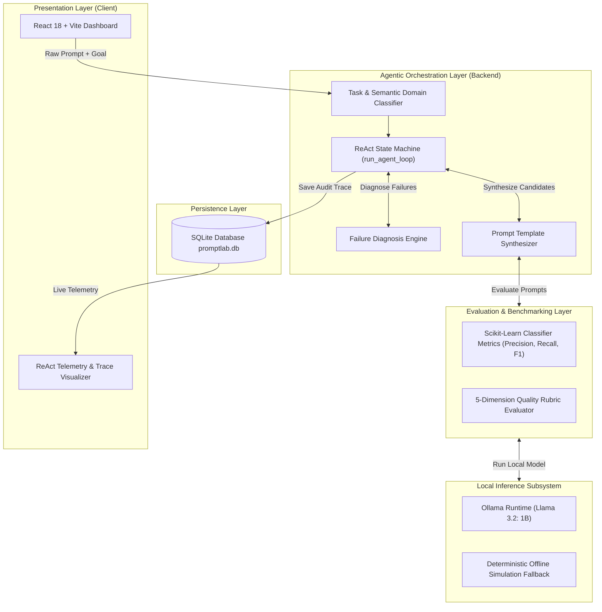

# PromptLab — Autonomous Agentic AI Prompt Engineering Studio

[](https://www.python.org/)
[](https://fastapi.tiangolo.com/)
[](https://react.dev/)
[](https://vitejs.dev/)
[](https://ollama.com/)
[](LICENSE)

**PromptLab** is a local-first, privacy-focused **Autonomous Agentic AI Studio** for systematic prompt engineering, benchmarking, and optimization. 

Unlike linear, single-pass LLM wrappers, PromptLab implements a **closed-loop ReAct (Reasoning + Acting) Agent** that takes underspecified, weak prompts and autonomously iteratively refines them into production-ready prompts using empirical benchmarks and a 5-dimension Prompt Engineering Quality Rubric.

---

## 🌟 Key Features

### 1. 🤖 Autonomous ReAct Agent Loop (Agentic AI)
- **Goal-Driven Optimization:** Users specify a target quality/accuracy goal (e.g., 90%).
- **ReAct Execution Cycle:** The agent operates in an autonomous closed loop:
  - 🟣 **THINK:** Diagnoses prompt domain, semantic flaws, and benchmark failure patterns.
  - 🔵 **ACT:** Invokes toolkits to synthesize improved candidate templates and execute benchmarks.
  - 🟢 **OBSERVE:** Collects metrics (Accuracy %, Quality Score, F1, Latency, Criteria Pass Rate).
  - 🟣 **DECIDE:** Evaluates whether target threshold is met; terminates early upon success or self-corrects in the next iteration.
- **Explainable AI (XAI):** Renders the agent’s internal reasoning step-by-step in the UI.

### 2. 🌐 Multi-Domain Task-Adaptive Intelligence
The agent dynamically routes and customizes prompt engineering across specialized domains:
- 💻 **Software & Code Engineering** (`explain python`, algorithms, debugging, SQL) $\rightarrow$ *Senior Software Architect & Technical Educator* templates with PEP 8 standards, runtime architecture, and runnable code blocks.
- ⚖️ **Legal & Contract Engineering** (`draft an NDA agreement`, compliance, contracts) $\rightarrow$ *Senior Corporate Counsel* templates with mutual covenants, statutory clauses, and jurisdictional disclaimers.
- 🩺 **Healthcare & Clinical Communication** (`explain diabetes symptoms`, diseases) $\rightarrow$ *Clinical Educator & Medical Communications Specialist* templates with pathophysiology, red-flag symptoms, and mandatory medical disclaimers.
- 📑 **Document Summarization & Extraction** (`summarize research paper`, digests) $\rightarrow$ *Executive Information Analyst* templates with bulleted takeaways and anti-hallucination constraints.
- 📊 **NLP Sentiment Classification** (`classify review sentiment`) $\rightarrow$ *Specialized Sentiment Classifier* enforcing strict single-word labels (`Positive` / `Negative`).
- 🧠 **General Reasoning & Analysis** $\rightarrow$ *Subject Matter Specialist & Analytical Consultant* with structured chain-of-thought guidelines.

### 3. 🧪 Dual-Modality Evaluation Engine
- **Empirical NLP Benchmarking:** Evaluates classification tasks using Scikit-Learn (Macro Precision, Recall, Macro F1, and Confusion Matrix).
- **5-Dimension Prompt Engineering Quality Rubric:** Evaluates generative prompts against 5 core criteria:
  1. *Role & Persona Specification*
  2. *Input Grounding & Context Delimiters (`{{input}}`)*
  3. *Structural Task Decomposition (Numbered/bulleted deliverables)*
  4. *Constraint & Standards Enforcement (Rules, schemas, negative constraints)*
  5. *Domain Depth & Technical Specificity*

### 4. 🔒 100% Local-First & Zero API Cost
- Powered by **Llama 3.2 (1B)** via local **Ollama** inference.
- Zero paid third-party API keys required ($0.00 cloud expenses).
- Built-in deterministic simulation fallback engine for instant offline demonstrations.

### 5. 🎨 Modern Glassmorphic Dark UI
- Obsidian Glassmorphic Dark Mode with Light Mode toggle (persisted via `localStorage`).
- Color-coded telemetry badges for ReAct execution steps.
- Real-time comparison side-by-side prompt execution testbed.

---

## 🏛️ System Architecture

PromptLab follows a **Decoupled Multi-Tier Architecture** integrated with a **Closed-Loop Cybernetic Feedback Control System**:



---

## 🛠️ Technology Stack

| Layer | Technologies |
| :--- | :--- |
| **Agentic AI** | ReAct (Reasoning + Acting), Domain Semantic Routing, 5-Dimension Rubric |
| **Local LLM Engine** | Ollama with `llama3.2:1b`, Offline Simulation Fallback |
| **Backend Framework** | Python 3.12, FastAPI, Uvicorn (ASGI) |
| **Data & ML Evaluation** | Pandas, Scikit-Learn (Precision, Recall, F1, Confusion Matrix) |
| **Database** | SQLite3 (`promptlab.db` with serialized JSON execution traces) |
| **Networking & Validation** | HTTPX (Async HTTP), Pydantic v2 |
| **Frontend Framework** | React 18, Vite, Vanilla CSS3 (Custom Glassmorphism Tokens) |
| **Typography** | Google Fonts (`Plus Jakarta Sans`, `Space Grotesk`, `JetBrains Mono`) |

---

## 🚀 Quick Start & Installation

### Prerequisites
- **Python 3.10+** ([python.org](https://www.python.org/))
- **Node.js 18+** ([nodejs.org](https://nodejs.org/))
- *(Optional)* **Ollama for Windows/Linux/macOS** ([ollama.com](https://ollama.com/))

---

### Step 1: Clone Repository
```bash
git clone https://github.com/sakshamkamra33/PromptLab.git
cd PromptLab
```

---

### Step 2: Setup & Run Backend

Open a terminal in the `backend/` directory:

```powershell
cd backend

# Create and activate Python virtual environment
python -m venv .venv
.\.venv\Scripts\activate

# Install dependencies
python -m pip install --upgrade pip
pip install -r requirements.txt

# Start the FastAPI server
python -m uvicorn main:app --reload --port 8000
```
*Backend runs on `http://127.0.0.1:8000` (Interactive Swagger docs: `http://127.0.0.1:8000/docs`).*

---

### Step 3: Setup & Run Frontend

Open a **second** terminal in the `frontend/` directory:

```powershell
cd frontend

# Install npm packages
npm install

# Start Vite development server
npm run dev
```
*Frontend runs on `http://localhost:5173`.*

---

### Step 4 (Optional): Enable Local Llama 3.2 Model
If you want to run actual local GPU/CPU inference instead of the built-in simulation fallback:
```powershell
ollama pull llama3.2:1b
ollama run llama3.2:1b
```

---

## 🎯 Example Prompts for Live Demonstration

Test these prompts in the **🤖 Agentic AI (Autonomous)** tab:

| Domain | Input Prompt to Enter | Optimization Result |
| :--- | :--- | :--- |
| **Software / Code** | `explain python` | Optimizes into a **Senior Software Architect** prompt enforcing execution model, memory management, PEP 8 code snippets, and common pitfalls. |
| **Legal / Contracts** | `draft an NDA agreement` | Optimizes into a **Senior Corporate Counsel** prompt with defined terms, standard confidentiality obligations, exclusions, and execution blocks. |
| **Healthcare / Medical** | `explain diabetes symptoms` | Optimizes into a **Clinical Educator** prompt with pathophysiology, acute/chronic symptoms, and mandatory medical disclaimers. |
| **Document Summarization** | `summarize this research paper: {{input}}` | Optimizes into an **Executive Information Analyst** prompt with high-density bulleted takeaways and anti-hallucination constraints. |
| **Sentiment / NLP** | `Classify the sentiment of this review: {{input}}` | Optimizes into a **Specialized Review Classifier** with strict single-word labels (`Positive`/`Negative`). |

---

## 📡 API Endpoints Reference

| Method | Endpoint | Description |
| :--- | :--- | :--- |
| `GET` | `/api/health` | Health check & Ollama connectivity status |
| `POST` | `/api/agent/run` | **Autonomous ReAct Agent Loop (Think → Act → Observe)** |
| `GET` | `/api/agent-runs` | List all historical agent optimization runs |
| `GET` | `/api/agent-runs/{id}` | Retrieve run details with full step-by-step reasoning trace |
| `POST` | `/api/run` | Single-pass prompt execution |
| `POST` | `/api/compare` | Side-by-side prompt output & latency comparison |
| `POST` | `/api/optimize` | Traditional multi-candidate benchmark optimization |
| `POST` | `/api/test` | Held-out validation test evaluation |

---

## 🎓 College Viva & Defense Questions

* **Q: Where is Agentic AI in this project?**  
  *A:* In `backend/main.py` inside `run_agent_loop()`. It implements an autonomous ReAct loop that executes Think $\rightarrow$ Act $\rightarrow$ Observe cycles, diagnosing failures and self-correcting until the target goal is met.
* **Q: How are generative tasks evaluated?**  
  *A:* Using the 5-dimension Prompt Engineering Quality Rubric (`evaluate_prompt_quality_rubric()`), which quantitatively scores Role Persona, Input Grounding, Decomposition, Constraints, and Specificity.
* **Q: What is the purpose of `{{input}}`?**  
  *A:* It separates static prompt engineering instructions (persona, rules, schemas) from runtime dynamic user data, making the prompt template reusable in production.

---

## 📄 License
This project is licensed under the MIT License — see the [LICENSE](LICENSE) file for details.
